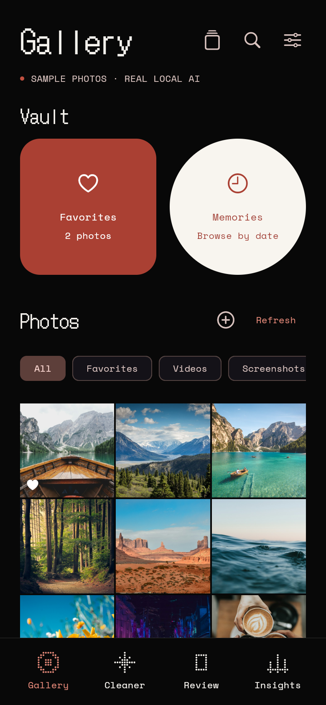

# Mikro

A privacy-first gallery cleaner. It uses on-device AI to sort photos and find similar images, and keeps every deletion under your control.



[Download the Android preview APK](https://github.com/daudibrahimhasan/kosmos/releases/latest/download/app-release.apk) · [All releases](https://github.com/daudibrahimhasan/kosmos/releases)


## What it does

- TinyCLIP assigns photo categories and finds semantically similar images.
- YuNet and SFace group familiar faces when you turn on People. It is off by default, and turning it off erases saved face data.
- A local preference model can make review suggestions after 100 explicit choices. It never deletes files on its own.
- Review uses a swipe deck. A left swipe only adds an item to the queue; you still review and confirm before anything is deleted.
- Native photos and analysis stay on your device. The browser preview stores imported copies in that browser and never changes the original files.

The categories, dates, file sizes and video entries in the sample library are demo data. Category and similarity inference uses the bundled sample photo pixels.

## Run it

Requires Flutter 3.47.9. Android builds target API 24+ and arm64. The iOS deployment target is 16.0.

```sh
flutter pub get
flutter run
```

To build an Android arm64 APK locally:

```sh
flutter build apk --release --target-platform android-arm64
```

Pushing a `v*` tag runs analysis, tests and the Android release build, then publishes a GitHub prerelease with the APK attached.

The preview APK uses the Android template's debug signing key. It is for installation/testing, not a Play Store upload or an in-place upgrade over a differently signed build.

## AI models

The app bundles the TinyCLIP image encoder, prompt prototypes, YuNet and SFace. All inference runs locally through ONNX Runtime. People grouping is opt-in. Model sources, licenses, hashes and validation notes are in [docs/ML_STACK.md](docs/ML_STACK.md) and [assets/models/manifest.json](assets/models/manifest.json).

The browser pipeline is smoke-tested on the bundled samples. Native phone performance, face grouping accuracy, battery use and thermal behavior still need device testing. Face matches can be wrong, so the app lets you correct groups and never uses them to delete photos.

## Checks

```sh
flutter analyze
flutter test
flutter build web --release --no-web-resources-cdn
```

The app uses a warm black, cream and rust palette with pixel headings, matching the supplied mockup.
